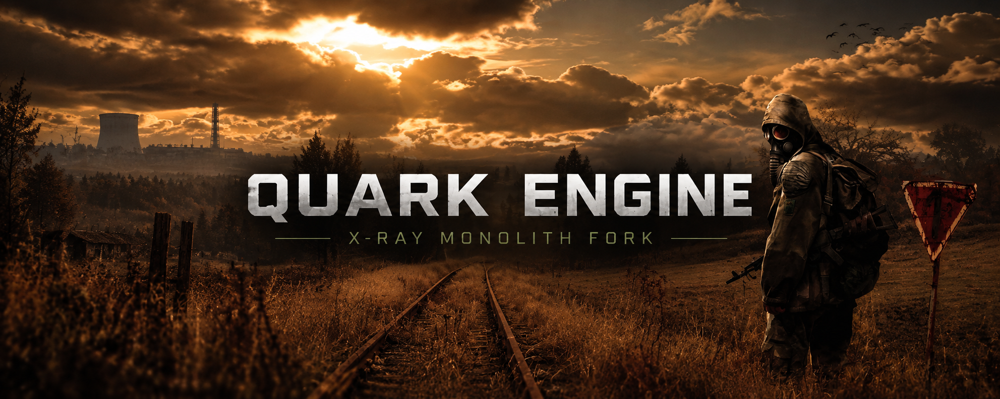
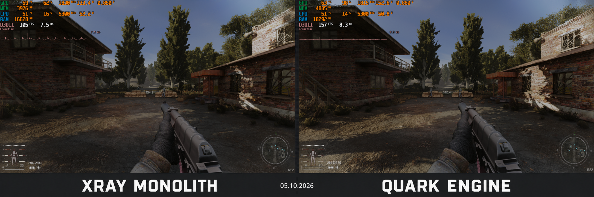
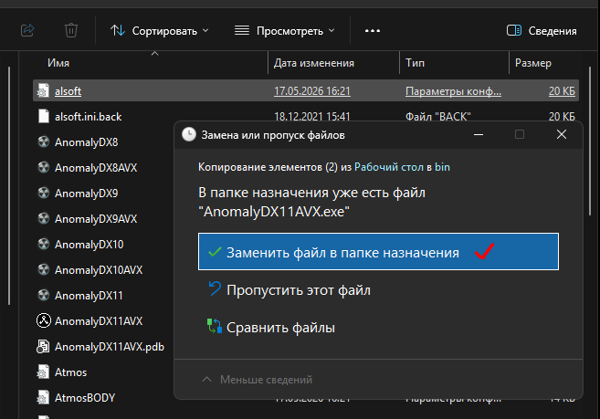
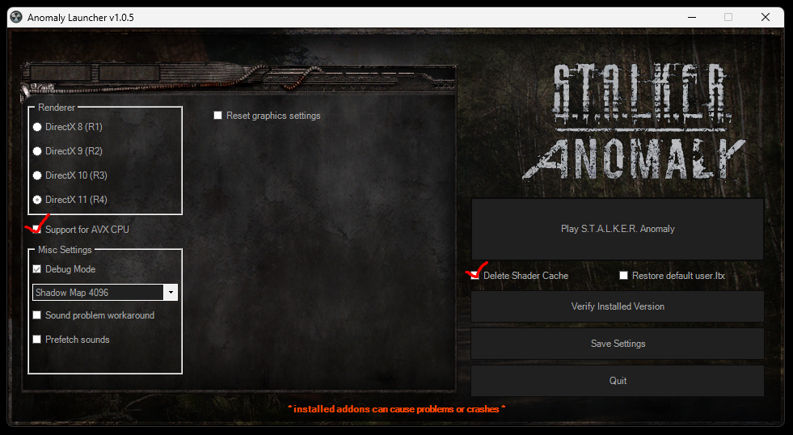
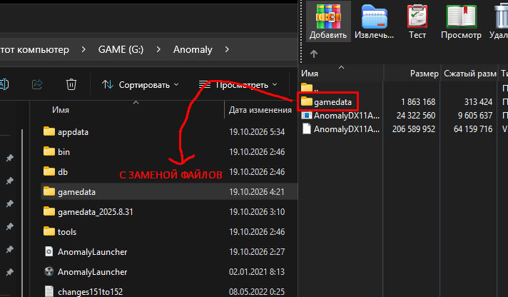

<p align="center">
  
</p>

<p align="center">
  
</p>

<p align="center">
  <b>English</b> & <a href="README.ru.md">Русский</a>
</p>

<p align="center">
  
  
  
  <a href="https://discord.com/invite/X7GRYsNNEc"></a>
</p>

<p align="center">
  <b>The project's goal is to optimize the use of modern hardware to improve performance and resolve numerous technical issues while maintaining compatibility with mods and modpacks.</b>
</p>

<p align="center">
  <a href="https://github.com/quark-engine-stalker/quark-engine/releases">Download / Releases</a> &
  <a href="#engine-installation-and-requirements">Installation</a> &
  <a href="CHANGELOG.md">Changelog</a> &
  <a href="#documentation">Documentation</a> &
  <a href="https://discord.com/invite/X7GRYsNNEc">Discord</a>
</p>

---

## Support and Changelog

The engine is tested with **STALKER: Anomaly 1.5.3** and **STALKER: GAMMA 0.9.5**.  
Update history: [CHANGELOG.md](CHANGELOG.md).

## Installation and Requirements

Your CPU must support **AVX2**. You must also install or update the [Microsoft Visual C++ Redistributable x64](https://aka.ms/vs/17/release/vc_redist.x64.exe).

1. Make sure STALKER: Anomaly 1.5.3 and STALKER: GAMMA 0.9.5 are installed correctly. Refer to their respective authors' instructions for installation guidance.
2. Download the latest `AnomalyDX11AVX.rar` from our GitHub repository. Extract the `.exe` and `.pdb` files into `Anomaly\bin`, replacing the existing files when prompted. **Make a backup first, just in case.**
3. Launch the game through MO2 (Mod Organizer). Select and launch **Anomaly Launcher**, enable the **Support for AVX CPU** and **Delete Shader Cache** options, then start the game. This is required to recompile the shaders.
4. If the game crashes while loading a save, copy the `gamedata` folder from the latest GitHub archive into the Anomaly root directory, replacing existing files. Then start a new game. **Make a backup first, just in case.**
5. It is recommended to keep the graphics settings at their default values.
6. If you encounter any errors, send us the logs from `AppData\Roaming\QUARK ENGINE\ERROR` via Discord. These files help us identify the cause of crashes and further improve the engine.

<p align="center">
  
  
  
</p>

## Source Code and Building

```text
quark-engine/
├── src/                 # Main engine source code
│   ├── 3rd party/       # Third-party libraries and their source code
│   └── QUARK ENGINE.sln
├── sdk/                 # Headers, codec sources, and libraries used for linking
├── docs/assets/         # README assets and installation illustrations
├── licenses/            # License texts for dependencies
├── CHANGELOG.md         # Version history in English
├── CHANGELOG.ru.md      # Version history in Russian
└── License.txt          # X-Ray distribution terms
```

The primary build configuration is **`DX11-AVX | x64`**. For details and the MSBuild command, see the [build guide](BUILDING.md).

## Documentation

| Document | English | Русский |
| :--- | :--- | :--- |
| Project overview and installation | [README](README.md) | [README](README.ru.md) |
| Building from source | [Building](BUILDING.md) | [Сборка](BUILDING.ru.md) |
| Version history | [Changelog](CHANGELOG.md) | [История изменений](CHANGELOG.ru.md) |
| Release description template | [Release template](docs/release-template.md) | [Шаблон релиза](docs/release-template.ru.md) |

## Community and Project Authors

Join us: **[QUARK ENGINE DISCORD](https://discord.com/invite/X7GRYsNNEc)**.  
QUARK ENGINE is based on [X-Ray Monolith](https://github.com/themrdemonized/xray-monolith).

## License

The original X-Ray Engine used by S.T.A.L.K.E.R. belongs to **GSC Game World**. Distribution terms: [License.txt](License.txt).
